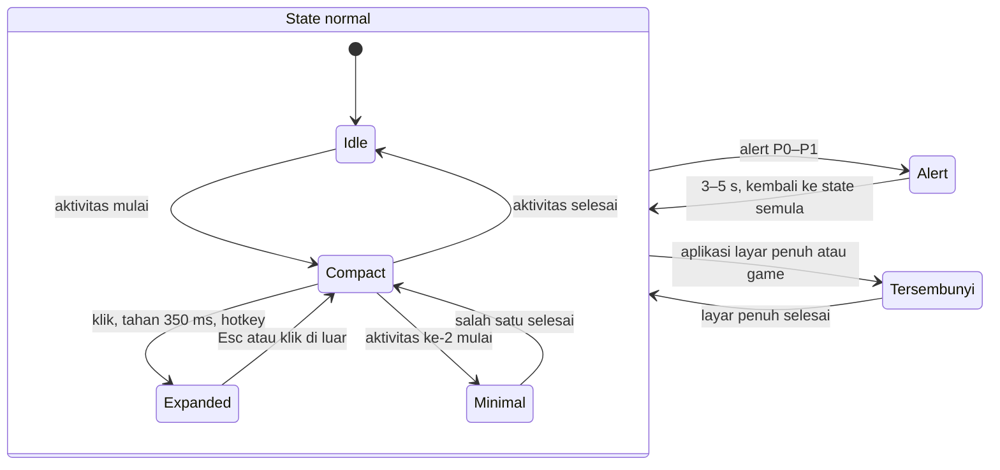
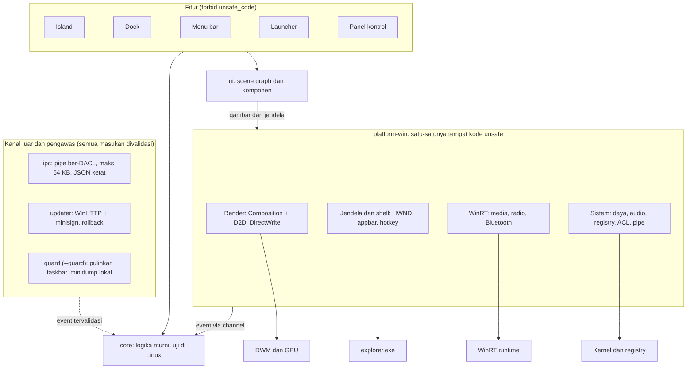

# PRD — Notchi: Island dan Dock untuk Windows 11 (Rust)

Tanggal: 2026-10-31 · Pemilik: devaldicaliesta · Status: draf untuk ditinjau

## 1. Ringkasan, tujuan, dan metrik

Produk ini adalah satu aplikasi Rust ringan untuk Windows 11 yang mengubah desktop menjadi pengalaman ala macOS: Island interaktif di tengah atas layar, menu bar atas, dan Dock di bawah. Nama produk: **Notchi**, sama dengan nama maskotnya (bagian 2.6); repositori GitHub tetap bernama `devnotch`. Jangan memakai nama merek Apple, lihat bagian 2.5.

**Keputusan yang sudah disepakati (31 Oktober 2026).**

| Topik | Keputusan | Dibahas di |
| --- | --- | --- |
| Prioritas | Island dikerjakan lebih dulu (Fase 1–2); Dock dan menu bar menyusul pada Fase 3 | 9.1 |
| Sistem operasi | Hanya Windows 11 22H2 (build 22621) ke atas; Windows 10 tidak didukung | 6 |
| Distribusi | Gratis, publik, sumber terbuka dengan lisensi MIT | 9.7 |
| Notifikasi | Dikemas sebagai MSIX agar punya package identity | 3.2, 9.2 |
| Media | Semua sumber yang tampil di kontrol media Windows, termasuk YouTube Music dan Apple Music | 3.6 |
| Identitas visual | Maskot orisinal berkarakter ceria dengan palet sendiri | 2.6 |

**Masalah.** Taskbar Windows statis, tidak punya ruang untuk informasi live (musik, timer, panggilan, pengisian daya), dan tidak bisa dibuat serupa macOS tanpa aplikasi berat berbasis Electron/WPF yang memakan ratusan MB RAM.

**Tujuan.**

1. Island yang bisa mengembang dari pil kecil menjadi kartu besar dengan animasi pegas, menampilkan aktivitas live.
2. Dock dengan magnifikasi, bounce, indikator aplikasi berjalan, stack folder, dan preview jendela.
3. Menu bar atas dengan menu aplikasi aktif, status ikon, jam, dan panel kontrol cepat.
4. Tampilan dan gerak setara macOS: material kaca, sudut kontinu (squircle), tipografi, dan kurva animasi pegas.
5. Ringan: satu proses utama, render sesuai kebutuhan (tanpa loop kosong), tanpa runtime web.
6. Aman secara default: tanpa hak admin, tanpa telemetri tersembunyi, update bertanda tangan.

**Bukan tujuan (versi 1).**

- Bukan pengganti shell Windows (`explorer.exe` tetap berjalan; kita bekerja bersamanya, bukan menggantikannya).
- Bukan emulator macOS atau penjalan aplikasi macOS.
- Tidak menyalin aset Apple (font SF Pro, ikon bawaan, wallpaper, logo).
- Tidak mendukung Windows 10, Linux, atau macOS.

**Pengguna sasaran.**

| Persona | Kebutuhan utama | Prioritas |
| --- | --- | --- |
| Pengguna estetika desktop (rice/ricing) | Tampilan mirip macOS, mudah diatur | Utama |
| Pengguna produktivitas dan pendengar musik | Kontrol media/timer cepat tanpa pindah jendela | Utama |
| Pindahan dari Mac ke PC | Alur kerja yang dikenal (Dock, menu bar, launcher) | Sekunder |
| Pemilik laptop/PC spesifikasi rendah | Footprint sangat kecil | Sekunder |

**Metrik sukses (target terukur, diverifikasi di CI dan di perangkat uji).**

| Metrik | Target | Cara ukur |
| --- | --- | --- |
| Ukuran `.exe` rilis | ≤ 12 MB | Build `--release`, LTO, `strip`, `panic=abort` |
| RAM idle (private working set) | ≤ 60 MB, semua modul aktif | Performance Monitor, 30 menit idle |
| CPU idle | ≤ 0,3% satu core | ETW / Process Explorer, tanpa animasi |
| Waktu mulai sampai terlihat | ≤ 400 ms | Cold start di SSD NVMe |
| Frame animasi | Sesuai refresh monitor (60–144 Hz), frame jatuh < 1% | Pengukuran frame-time internal |
| GPU idle (iGPU) | < 2% | Task Manager / PresentMon |
| Sesi bebas crash | ≥ 99,5% | Laporan crash lokal opt-in |
| Kemiripan visual | Skor ≥ 4 dari 5 pada uji buta 20 penguji | Perbandingan berdampingan dengan rekaman referensi |

## 2. Spesifikasi visual dan catatan legal

Tampilan dibuat **setara dalam proporsi, material, dan gerak** dengan macOS, tetapi dengan aset orisinal; "sama persis" sampai piksel tidak realistis di Windows dan berisiko hukum. Semua angka di bawah adalah nilai awal yang dikalibrasi ulang dari rekaman referensi (Fase 1) dan disimpan sebagai token yang bisa diubah tanpa mengubah kode.

### 2.1 Material kaca

macOS Tahoe 26 memakai material Liquid Glass di Dock, menu bar, dan Control Center. Menu bar-nya transparan, dan opsi Reduce Transparency mengembalikan tampilan solid ([MacRumors](https://www.macrumors.com/roundup/macos-26/), [Eclectic Light](https://eclecticlight.co/2025/11/05/appearance-revisited-get-tahoe-26-1-looking-in-better-shape/)). Di Windows, efek yang sama dibangun dari lapisan berikut, dari bawah ke atas:

1. Backdrop blur (Gaussian) dari konten di belakang jendela.
2. Tint adaptif (terang/gelap mengikuti tema Windows) dengan boost saturasi.
3. Noise halus untuk menghindari banding.
4. Highlight spekular: garis 1 dp di tepi atas dan gradien lembut di sudut.
5. Bayangan lembut di luar bentuk.

| Token | Nilai awal | Catatan |
| --- | --- | --- |
| Radius blur | 24 dp | Dibatasi 32 dp agar GPU tetap ringan |
| Tint mode terang | putih 14% | Disesuaikan otomatis dari luminans wallpaper |
| Tint mode gelap | hitam 28% | |
| Saturasi backdrop | 1,7× | |
| Garis tepi | 1 dp, putih 22% (atas) → 6% (bawah) | |
| Mode Reduce Transparency | Warna solid + garis tepi tipis | Otomatis bila Windows "Transparency effects" mati |

### 2.2 Bentuk, tipografi, ikon

| Elemen | Spesifikasi awal |
| --- | --- |
| Sudut | Kontinu (squircle) untuk ikon dan Dock; busur lingkaran untuk pil Island |
| Font | **Inter** (lisensi OFL, di-embed, subset Latin) sebagai pengganti SF Pro; font sistem sebagai fallback CJK/Arab |
| Menu bar | Tinggi ≈ 24 dp; teks 13 dp; nama aplikasi aktif tebal |
| Judul Island | 15 dp semibold; subjudul 13 dp, putih 60% |
| Ikon Dock | Ukuran dasar 56 dp (default), bisa 32–96 dp; magnifikasi hingga 1,9× |
| Gaya ikon | **Asli** (ikon Windows apa adanya) atau **Ubin** (ikon diletakkan di ubin squircle bergradien dari warna dominan ikon) |
| Tema | Mengikuti `AppsUseLightTheme` dan warna aksen Windows |

### 2.3 Gerak (motion)

Semua animasi memakai fisika pegas, bukan kurva easing tetap. Preset meniru semantik `Spring(duration:bounce:)` di SwiftUI: parameter `duration` (d) dan `bounce` (b), dikonversi ke pegas massa 1:

```latex
k = \left(\frac{2\pi}{d}\right)^2 \qquad c = \frac{4\pi\,(1-b)}{d}
```

| Preset | duration | bounce | Dipakai untuk |
| --- | --- | --- | --- |
| smooth | 0,32 s | 0,00 | Pindah konten dalam kartu, fade |
| snappy | 0,26 s | 0,12 | Magnifikasi Dock, hover |
| bouncy | 0,38 s | 0,25 | Island mengembang/mengecil, pil turun dari tepi atas, bounce ikon |

Nilai awal (0,50/0,40/0,50 s) terasa lambat saat diuji, sehingga dipercepat; semua preset kini settle dalam 400 ms.

Animasi berjalan di thread compositor GPU (lihat bagian 6) agar tetap mulus saat thread UI sibuk. Bila Windows "Animation effects" dimatikan (`SPI_GETCLIENTAREAANIMATION`), semua animasi diganti crossfade 120 ms.

### 2.4 Aksesibilitas

- Kontras teks minimal WCAG AA di atas material kaca (tint naik otomatis bila luminans backdrop tinggi).
- Seluruh kontrol dapat dioperasikan dengan keyboard dan terbaca oleh Narrator melalui UI Automation.
- Mendukung High Contrast Windows: material kaca dimatikan, warna sistem dipakai.

### 2.5 Catatan legal dan kekayaan intelektual

Ini bukan nasihat hukum; konsultasikan dengan penasihat hukum sebelum rilis publik.

| Risiko | Kebijakan produk |
| --- | --- |
| Merek dagang (Dynamic Island, Dock, macOS, Liquid Glass, Spotlight, Control Center) | Tidak dipakai di nama produk, nama exe, ikon, atau toko aplikasi. Di dokumentasi hanya sebagai deskripsi ("gaya ala…"), dengan pernyataan bahwa produk tidak berafiliasi dengan Apple |
| Font SF Pro | Lisensinya membatasi penggunaan pada platform Apple, jadi **tidak di-embed**; pakai Inter |
| Ikon, wallpaper, suara, logo Apple | Tidak disalin; semua aset dibuat sendiri atau berlisensi terbuka |
| Desain yang dilindungi (trade dress/paten desain) | Tinjauan hukum di akhir Fase 1; token desain dibuat dapat diubah bila perlu menjauh dari tampilan aslinya |
| Lisensi dependensi | Hanya MIT/Apache-2.0/OFL dan sejenisnya; audit otomatis dengan `cargo deny` di CI |

### 2.6 Maskot dan palet warna

Island memiliki maskot orisinal bernama **Notchi**, yang sekaligus menjadi nama dan wajah produk: makhluk kecil bulat berwajah titik yang tinggal di dalam pil dan berubah ekspresi mengikuti aktivitas. Suasananya terinspirasi karakter ceria pada produk agen Dots dari OpenAI, yang masing-masing punya bentuk dan warna sendiri, seperti segitiga berdasi kupu-kupu, kelinci berheadphone, dan awan berbaret ([Fast Company](https://www.fastcompany.com/91615068/openai-dots-agent-crew-of-friendly-mascots)). Karakter itu milik OpenAI, jadi Notchi **tidak** meniru bentuk, nama, maupun palet persisnya; yang diambil hanya gagasan umum "karakter kecil yang ramah dan punya warna berbeda per varian".

| Aktivitas | Ekspresi Notchi | Gerak |
| --- | --- | --- |
| Idle | Mata titik berkedip pelan | Napas halus (skala 1,00–1,03) |
| Musik atau video diputar | Mata terpejam, tubuh berayun | Ayunan tetap, bukan analisis audio, agar hemat CPU |
| Timer berjalan | Mata melirik angka hitung mundur | Berkedip pada detik terakhir |
| Mengisi daya | Mata berbentuk kilat kecil | Satu percikan lalu tenang |
| Baterai rendah | Mata setengah terbuka, menguap | Gerak lambat |
| Notifikasi atau alert | Mata membesar | Melompat sekali dengan preset *bouncy* |
| Mikrofon/kamera aktif | Notchi mengecil ke samping; titik privasi tampil jelas | Indikator privasi tidak pernah digantikan maskot |
| Layar penuh atau Reduce Motion | Pose netral statis | Tanpa animasi |

Notchi digambar sebagai bentuk vektor (shape Composition), bukan bitmap, sehingga seluruh set ekspresi kurang dari 30 KB. Kedip dan napas dijalankan sebagai animasi berulang di compositor, jadi tidak membangunkan thread aplikasi dan tidak melanggar anggaran idle (bagian 8.1).

| Token | Nilai awal | Dipakai untuk |
| --- | --- | --- |
| island-bg | `#000000` | Latar pil Island |
| text-primary | `#FFFFFF` | Judul |
| text-secondary | putih 60% | Subjudul |
| skin-langit (default) | `#4DA8FF` | Tubuh Notchi |
| skin-karang | `#FF7A66` | Varian tubuh |
| skin-mint | `#3DD6A0` | Varian tubuh; aksen pengisian daya |
| skin-lemon | `#FFD23F` | Varian tubuh; aksen alert |
| skin-lavender | `#A58BFF` | Varian tubuh |
| skin-permen | `#FF8FC7` | Varian tubuh |
| status-kritis | `#FF5A5F` | Baterai rendah dan kesalahan |

Nilai warna adalah usulan awal yang harus lulus kontras WCAG AA (4,5:1) di atas `#000000` dan ditinjau desainer sebelum Fase 1 selesai. Pengguna memilih satu varian tubuh atau mematikan maskot sepenuhnya.

## 3. Fitur Island (pil interaktif di tengah atas layar)

Island adalah jendela kecil berbentuk pil, selalu di atas, yang berubah ukuran mengikuti aktivitas live yang sedang berjalan. Di iPhone fitur ini bernama Dynamic Island; di Mac, Tahoe menampilkan Live Activities dari iPhone di menu bar ([MacStories](https://www.macstories.net/news/macos-tahoe-the-macstories-overview/)), sehingga Island di sini adalah gabungan keduanya untuk Windows. Karena PC tidak punya notch, perilakunya dapat dipilih (`island.behavior`, juga di jendela Pengaturan dan menu klik kanan): **Otomatis** (`autohide`, default), **Menempel** (`sticky`, selalu tampil), dan **Sembunyi** (`hide`, hanya muncul saat ada aktivitas atau alert). Pada Fase 1 Island berjalan sebagai overlay tanpa menu bar.

Island **menempel di tepi atas layar** seperti notch: sisi atasnya rata dengan tepi layar, sudut bawahnya membulat, dan di pertemuan dengan tepi ada lengkung cekung kecil (10 dp) sehingga pil tampak seperti cairan yang menetes dari tepi. Pada perilaku **Otomatis**, Island masuk ke tepi atas dan hanya menyisakan bibir 4 dp; ia turun saat kursor masuk ke zona tipis (10 dp) di sekitar notch dan naik lagi 300 ms setelah kursor pergi. Alert, kartu yang terbuka, dan aktivitas baru (menyembul 2,5 detik) selalu tampil penuh. Saat tersembunyi, isi pil dilepas sehingga tidak ada animasi maupun timer yang berjalan.

### 3.1 State dan ukuran

| State | Kapan muncul | Ukuran awal (dp) | Isi |
| --- | --- | --- | --- |
| Idle | Tidak ada aktivitas | 126 × 37 | Pil gelap kosong (atau tersembunyi, sesuai perilaku) |
| Compact | 1 aktivitas | 160–240 × 37 | Slot kiri (ikon/sampul) dan slot kanan (indikator/waveform) |
| Minimal | 2 aktivitas | Pil utama + gelembung 37 × 37 | Aktivitas kedua terpisah di sisi kanan |
| Expanded | Klik, tahan 350 ms, atau alert | 371 × 84–240 | Kartu kontrol penuh (kartu media dengan lirik 240) |
| Alert | Peristiwa singkat (pengisi daya, perangkat terhubung) | Expanded otomatis 3–5 detik | Kembali ke state sebelumnya |

Angka ukuran adalah titik awal yang meniru proporsi pada iPhone dan dikalibrasi ulang di Fase 1. Perpindahan antar-state memakai morf bentuk (ukuran dan radius berubah mulus), konten lama memudar dengan blur singkat, dan konten baru muncul setelah bentuk hampir selesai, dengan preset gerak *bouncy* (bagian 2.3).



Alert dan layar penuh dapat menyela state normal mana pun; setelah selesai, Island kembali ke state sebelum interupsi.

### 3.2 Aktivitas live

| Aktivitas | Sumber data di Windows | Catatan | Fase |
| --- | --- | --- | --- |
| Media (musik, video) | `GlobalSystemMediaTransportControlsSessionManager` (Windows 10 1809+): judul, artis, sampul, progres, tombol play/pause/next/prev | Bekerja untuk YouTube Music (browser atau PWA), Apple Music untuk Windows, Spotify, dan pemutar lain yang mendaftar ke kontrol media sistem; rincian di bagian 3.6 ([Microsoft Learn](https://learn.microsoft.com/en-us/uwp/api/windows.media.control.globalsystemmediatransportcontrolssessionmanager)) | 1 |
| Timer, stopwatch, alarm | Internal aplikasi | Tampil di compact sebagai hitung mundur | 1 |
| Pengisian daya, baterai rendah | `GetSystemPowerStatus` + `RegisterPowerSettingNotification` | Alert saat kabel dicolok/dicabut dan di 20%/10% | 1 |
| HUD volume dan kecerahan | `IAudioEndpointVolume` (callback), DDC/CI untuk kecerahan monitor | Mengganti OSD Windows hanya bila pengguna mengaktifkan; menyembunyikan OSD bawaan memakai cara tidak resmi sehingga opsional | 2 |
| Mikrofon/kamera sedang dipakai | Registry `CapabilityAccessManager\ConsentStore`: nilai `LastUsedTimeStop` = 0 berarti sedang dipakai ([contoh penggunaan](https://skillsmp.com/creators/deadlyapps/speedreader/github-skills-windows-call-detection)) | Titik indikator privasi; tidak bisa mendeteksi status mute | 2 |
| Notifikasi aplikasi | Membaca notifikasi aplikasi lain butuh `UserNotificationListener`, yang memerlukan package identity; aplikasi dikemas sebagai MSIX sehingga syarat ini terpenuhi ([Microsoft Learn](https://learn.microsoft.com/en-us/windows/apps/package-and-deploy/packaging)) | Pengguna memberi izin saat pertama dipakai; perilaku dibuktikan di spike Fase 0. Build portabel tanpa MSIX hanya menampilkan notifikasinya sendiri | 2 |
| Perangkat Bluetooth tersambung | `Windows.Devices.Enumeration.DeviceWatcher` + properti baterai perangkat | Kartu nama dan baterai; tidak semua perangkat melaporkan baterai | 2 |
| Unduhan | Pantau folder Downloads (`ReadDirectoryChangesW`), berkas `.crdownload`/`.part` | Heuristik, bukan data resmi dari browser | 2 |
| Live Activity dari aplikasi lain | CLI dan named pipe lokal (`notchctl push`) dengan skema JSON tervalidasi | Dasar ekosistem plugin; aturan keamanan di bagian 7 | 2 |
| File Shelf | Seret berkas ke Island untuk disimpan sementara, seret keluar kemudian | Lewat OLE drag-and-drop; tidak menyalin berkas tanpa izin pengguna | 2 |
| Cuaca | API publik tanpa kunci, hanya bila pengguna mengaktifkan jaringan | Opt-in | Pasca-1.0 |

### 3.3 Interaksi

| Aksi | Hasil |
| --- | --- |
| Hover pada pil | Pil membesar 1,05× dan menampilkan petunjuk (peek); mata maskot mengikuti kursor, tombol membesar saat disorot dan mengecil saat ditekan |
| Klik maskot di kartu | Maskot memantul (squash-stretch), tersipu, dan memercikkan partikel |
| Klik | Expand/collapse |
| Tahan 350 ms | Expand dengan umpan balik gerak (tanpa haptic di PC) |
| Klik kanan | Menu: Timer, Stopwatch, Perilaku, Sembunyikan 1 jam, Mulai bersama Windows, Pengaturan, Tentang, Keluar |
| Geser dua jari / seret horizontal | Ganti ke aktivitas berikutnya atau sebelumnya |
| Scroll di atas pil | Mengatur volume media |
| Esc atau klik di luar | Collapse |
| Hotkey global (dapat diubah) | Buka/tutup Island tanpa mouse |
| Layar sentuh | Tap, tahan, dan geser setara mouse |

Island **tidak boleh mencuri fokus**: jendela memakai gaya `WS_EX_NOACTIVATE`, kecuali saat ada input teks (misalnya mengubah timer), dan fokus dikembalikan ke aplikasi sebelumnya sesudahnya. Island otomatis disembunyikan saat aplikasi layar penuh atau game berjalan (`SHQueryUserNotificationState`).

### 3.4 Prioritas dan antrean

Bila beberapa aktivitas berjalan sekaligus, urutan prioritas: (P0) mikrofon/kamera aktif, (P1) alert sistem seperti baterai rendah, (P2) timer, (P3) media, (P4) unduhan dan lainnya. Dua aktivitas teratas tampil sebagai Minimal; sisanya masuk carousel yang bisa digeser. Alert P0–P1 menyela aktivitas lain selama 3–5 detik lalu mengembalikan state sebelumnya.

### 3.5 Kriteria penerimaan Island

- [ ] Dari klik sampai frame pertama bergerak ≤ 16 ms; animasi selesai (settle) ≤ 500 ms.
- [ ] Animasi tetap mulus saat thread UI sibuk 100 ms (animasi berjalan di compositor).
- [ ] Mengklik Island tidak mengubah jendela aktif (diuji otomatis dengan `GetForegroundWindow`).
- [ ] Island tersembunyi di game layar penuh dan muncul kembali dalam ≤ 1 detik setelah keluar.
- [ ] Metadata media tampil benar untuk Spotify, Chrome, dan Windows Media Player.
- [ ] Dengan Reduce Motion, tidak ada animasi pegas; hanya crossfade.

### 3.6 Sumber media: YouTube Music, Apple Music, dan lainnya

Island menampilkan semua sesi yang terdaftar di kontrol media sistem Windows, sehingga YouTube Music dan Apple Music didukung selama sumbernya mengumumkan sesi ke Windows. Sumber dikenali dari `SourceAppUserModelId` pada tiap sesi; aplikasi tidak membaca isi layar, tidak menyadap jaringan, dan tidak menyuntik skrip ke browser.

| Sumber | Cara tampil di Windows | Status verifikasi |
| --- | --- | --- |
| YouTube Music (music.youtube.com di Chrome atau Edge, termasuk PWA) | Browser Chromium meneruskan Media Session API halaman ke kontrol media sistem ([Windows Latest](https://windowslatest.com/2019/01/29/google-chrome-could-get-hardware-media-keys-support-in-windows)) | Diuji di Fase 0 pada Chrome dan Edge |
| Apple Music untuk Windows (Microsoft Store) | Aplikasi mendukung kontrol media Windows dan pintasan keyboard sejak pembaruan 2023 ([9to5Mac](https://9to5mac.com/2023/04/25/apple-music-windows-media-keys-lyrics-more/)) | Diuji di Fase 0 pada rilis terbaru |
| Apple Music di web (music.apple.com) | Lewat browser; bergantung pada dukungan Media Session situs. Satu sumber lama menyebut tidak terhubung ke kontrol media ([Chris Duke](https://chrisduke.tv/?p=9630)) | Diuji di Fase 0; tidak dijanjikan |
| Spotify dan pemutar lokal | Mendaftar ke kontrol media sistem | Diuji di Fase 1 |
| Video (YouTube, layanan streaming di browser) | Sesi video dengan judul dan kontrol sesuai kemampuan sesi | Diuji di Fase 1 |

- **Banyak sesi:** Island memakai sesi yang dinilai sistem paling mungkin dikontrol pengguna (`GetCurrentSession`), dan pengguna dapat berpindah sesi dengan geser. Ada daftar izin/blokir per sumber di pengaturan.
- **Kontrol:** tombol play, pause, next, dan previous tampil hanya bila sesi mengaktifkan kemampuan itu; bila tidak, tombol disembunyikan dan tidak menimbulkan galat.
- **Sampul dan progres:** sampul dari properti media sesi, dibatasi 512 px dan tidak disimpan ke disk; progres dari properti timeline sesi.
- **Merek:** ikon sumber diambil dari aplikasi atau browser yang bersangkutan lewat shell; Notchi tidak membawa logo YouTube Music atau Apple Music sendiri.
- **Lirik (opt-in, mati secara default):** API media Windows tidak menyediakan lirik, jadi lirik diambil dari [LRCLIB](https://lrclib.net) (`/api/get`, lalu `/api/search` sebagai cadangan) lewat WinHTTP: TLS 1.2/1.3, tanpa cookie, batas waktu 5–8 detik, respons maksimum 512 KB, satu thread pendek per lagu setelah jeda 350 ms. Yang dikirim hanya judul, artis, album, dan durasi; hasilnya disimpan di memori (12 lagu terakhir) dan tidak ke disk. Lirik tersinkron (LRC) bergeser per baris mengikuti posisi lagu; lirik polos dibagi rata sepanjang durasi. Saklar ada di Pengaturan dan tombol mikrofon di kartu media (`media.lyrics`).
- **Batas:** sumber yang tidak mengumumkan sesi ke Windows tidak akan muncul; tombol suka tidak tersedia karena tidak ada di API.

Kriteria penerimaan:

- [ ] Judul, artis, sampul, dan progres benar untuk YouTube Music (Chrome dan Edge) dan Apple Music (aplikasi Windows).
- [ ] Play/pause dan next/previous dari Island bekerja pada keduanya.
- [ ] Pergantian sumber aktif ≤ 300 ms dan tidak menampilkan data sumber sebelumnya.

## 4. Fitur Dock (pengganti taskbar bawah, Fase 3)

Dock adalah bar ikon mengambang di bawah layar yang menampilkan aplikasi tersemat, aplikasi berjalan, folder, dan Recycle Bin, lengkap dengan magnifikasi dan animasi pegas. Dock berjalan **berdampingan** dengan `explorer.exe`, bukan menggantikannya.

### 4.1 Strategi terhadap taskbar Windows

| Keputusan | Pendekatan | Alasan |
| --- | --- | --- |
| Menyembunyikan taskbar bawaan | Mengatur taskbar ke auto-hide lewat `SHAppBarMessage(ABM_SETSTATE)`; nilai awal pengguna disimpan dan dikembalikan saat aplikasi keluar | Cara resmi dan dapat dibatalkan; tidak menyuntik proses `explorer.exe` |
| Memesan ruang layar | Dock mendaftar sebagai appbar (`ABM_NEW`, `ABM_QUERYPOS`, `ABM_SETPOS`) agar jendela yang di-maximize tidak tertutup | API appbar memang dirancang agar sistem menyesuaikan area kerja ([Microsoft Learn](https://learn.microsoft.com/en-us/windows/win32/api/shellapi/nf-shellapi-shappbarmessage)) |
| Magnifikasi melewati batas appbar | Ruang yang dipesan setinggi Dock normal; jendela overlay transparan yang lebih tinggi menampung ikon yang membesar, dengan area kosong dibuat *click-through* lewat `WM_NCHITTEST` | Ikon membesar tidak mendorong jendela lain |
| Pemulihan setelah crash | Proses kecil `watchdog` (mode `--guard`) mengembalikan pengaturan taskbar bila proses utama mati tak wajar | Pengguna tidak boleh terjebak tanpa taskbar |
| Tombol darurat | Hotkey `Ctrl+Alt+Shift+T` dan perintah `--restore-taskbar` | Cara keluar yang pasti |

### 4.2 Fitur

| Fitur | Perilaku | Implementasi di Windows | Fase |
| --- | --- | --- | --- |
| Aplikasi tersemat | Atur urutan dengan seret; tambah lewat seret dari Start/Explorer | Daftar milik sendiri (JSON); ikon dari `IShellItemImageFactory` hingga 256 px; aplikasi UWP lewat `shell:AppsFolder` dan `IApplicationActivationManager` | 3 |
| Aplikasi berjalan + titik indikator | Titik kecil di bawah ikon aplikasi yang terbuka | Pantau jendela dengan `SetWinEventHook` (bukan polling); filter gaya Alt-Tab (terlihat, tidak *cloaked*, bukan tool window, tanpa owner); kelompokkan per AppUserModelID | 3 |
| Magnifikasi | Ikon di dekat kursor membesar hingga 1,9× dengan falloff halus pada ±3 ikon | Skala dianimasikan pegas *snappy*; kurva falloff kosinus yang parameternya dapat diubah | 3 |
| Bounce | Ikon memantul saat aplikasi dibuka sampai jendelanya muncul (maks. 10 detik) dan saat jendela meminta perhatian | Deteksi lewat shell hook (`HSHELL_FLASH`) dan jendela baru dari proses yang diluncurkan | 3 |
| Klik dan klik kanan | Klik: buka atau fokuskan; klik kanan: daftar jendela, Pertahankan di Dock, Tutup, Keluar | `ShellExecuteExW`, `SetForegroundWindow` dengan izin yang benar, `WM_CLOSE` | 3 |
| Label ikon | Tooltip kaca di atas ikon saat hover | Jendela layer ringan | 3 |
| Auto-hide, posisi, ukuran | Bawah/kiri/kanan, ukuran 32–96 dp, sembunyi otomatis dengan animasi | Konfigurasi per monitor | 3 |
| Preview jendela | Hover 600 ms menampilkan miniatur live | DWM thumbnail (`DwmRegisterThumbnail`), dirender GPU tanpa menyalin piksel ke CPU | 4 |
| Stack folder | Downloads dan Documents tampil sebagai kipas atau grid dengan thumbnail | `IShellItemImageFactory`, `IShellFolder`; animasi kipas berbasis pegas | 4 |
| Recycle Bin | Ikon penuh/kosong, buka, kosongkan | `SHQueryRecycleBin`, `SHEmptyRecycleBin` dengan konfirmasi | 4 |
| Seret berkas ke ikon | Berkas dibuka dengan aplikasi tersebut | `IDropTarget` dari target pintasan | 4 |
| Banyak monitor | Dock di monitor utama, semua monitor, atau mengikuti kursor | Per-monitor DPI v2, `WM_DPICHANGED` | 4 |
| Aplikasi terbaru | 3 aplikasi terakhir di sisi kanan pemisah | Daftar internal | 4 |
| Jump List | Menampilkan tugas dan item terbaru aplikasi | Perlu riset; tidak ada API publik sederhana untuk membaca Jump List aplikasi lain | Pasca-1.0 |

### 4.3 Batasan yang harus diterima

- **Badge angka (misalnya 5 email belum dibaca)** tidak bisa dibaca dari ikon taskbar karena Windows tidak membuka overlay icon aplikasi lain lewat API publik. Badge baru tersedia lewat pencerminan notifikasi Island (Fase 2), lalu ditampilkan di Dock pada Fase 3.
- **Animasi minimize ala genie** untuk jendela aplikasi lain tidak realistis: animasi minimize dimiliki DWM dan atribut jendela proses lain tidak dapat diubah oleh kita. Gantinya, ikon Dock berdenyut dan miniatur kecil terbang ke ikon (pasca-1.0, eksperimen).
- **Mengganti taskbar Windows 11 sepenuhnya** (termasuk tray sistem) membutuhkan teknik tidak resmi yang rapuh terhadap pembaruan Windows. Produk ini sengaja tidak menempuhnya.

### 4.4 Kriteria penerimaan Dock

- [ ] Jendela yang di-maximize berhenti tepat di atas Dock (area kerja benar) pada 100%, 150%, dan 200% DPI.
- [ ] Magnifikasi 60 fps+ dengan 20 ikon di iGPU kelas menengah; CPU < 3% selama animasi.
- [ ] Daftar aplikasi berjalan sama dengan Alt-Tab (tanpa jendela hantu) dalam uji 50 aplikasi.
- [ ] Setelah crash paksa, taskbar bawaan kembali dalam ≤ 5 detik.
- [ ] Dock tidak terlihat di aplikasi layar penuh dan tidak mengganggu game.

## 5. Menu bar, panel kontrol, launcher, dan pengaturan

Menu bar atas melengkapi Dock dan menjadi "rumah" Island pada Fase 3: bar tipis selebar layar yang menampilkan aplikasi aktif di kiri dan status sistem di kanan. Saat Island aktif, tinggi menu bar naik dari ≈ 24 dp ke ≈ 37 dp agar pil muat di dalamnya, mirip MacBook ber-notch, sehingga Island tidak menutupi bilah judul aplikasi. Bar ini juga didaftarkan sebagai appbar di tepi atas.

### 5.1 Menu bar

| Fitur | Perilaku | Implementasi dan batasan | Fase |
| --- | --- | --- | --- |
| Tampilan | Tiga pilihan: Transparan (default, gradien tipis demi keterbacaan), Kaca, Solid | Mengikuti pola macOS Tahoe yang menjadikan menu bar transparan dan menyediakan opsi mengembalikannya ([MacStories](https://www.macstories.net/?p=79028)) | 3 |
| Tombol utama di kiri | Menu sistem: Tentang, Pengaturan, Kunci layar, Tidur, Restart, Matikan (dengan konfirmasi) | Memakai **logo orisinal**, bukan logo Apple | 3 |
| Nama aplikasi aktif | Nama tebal dari jendela latar depan | `SetWinEventHook(EVENT_SYSTEM_FOREGROUND)`, nama dari `FileDescription` | 3 |
| Menu aplikasi aktif | Menampilkan menu jendela aktif di bar | Hanya untuk aplikasi Win32 klasik yang memakai `HMENU` (dibaca lewat `GetMenu`, dijalankan lewat `WM_COMMAND`). Aplikasi dengan menu gambar sendiri (Electron, UWP) tidak didukung; menu cadangan berisi Jendela (Minimize, Maximize, Pindah monitor, Tutup) | 4 |
| Jam dan tanggal | Format yang dapat diubah; klik membuka kalender | Kalender milik sendiri; tanpa integrasi akun di v1 | 3 |
| Status: baterai, Wi-Fi, Bluetooth, volume | Ikon dan persentase; klik membuka panel kontrol | `GetSystemPowerStatus`, API WLAN, `Windows.Devices.Radios` | 3 |
| Ikon tray aplikasi lain | **Tidak dicerminkan di v1**: Windows tidak menyediakan API publik untuk menyebutkan ikon tray aplikasi lain | Akses lewat taskbar bawaan yang disembunyikan otomatis (arahkan kursor ke tepi bawah) atau tombol "Tray" yang mengirim `Win+B` (eksperimen) | Pasca-1.0 |
| Sembunyi di layar penuh | Otomatis | `SHQueryUserNotificationState` | 3 |
| Sudut aktif (hot corners) | Aksi per sudut layar, misalnya Task View (`Win+Tab`) | Hook mouse level rendah dibatasi hanya pada deteksi posisi, tanpa merekam tombol | Pasca-1.0 |

### 5.2 Panel kontrol cepat

Popover kaca yang terbuka dari ikon di menu bar, berisi ubin yang dapat disusun ulang (Fase 4).

| Ubin | Fungsi | API |
| --- | --- | --- |
| Wi-Fi, Bluetooth | Nyala/mati radio, daftar jaringan/perangkat | `Windows.Devices.Radios` (butuh izin pengguna), WLAN API |
| Volume dan keluaran | Slider volume, pilih perangkat audio | `IAudioEndpointVolume`, `IMMDeviceEnumerator` |
| Kecerahan | Slider kecerahan layar | WMI (laptop) atau DDC/CI (monitor eksternal) |
| Sedang diputar | Ubin kontrol media yang sama dengan Island | Windows.Media.Control |
| Mode gelap | Alihkan tema aplikasi dan sistem | Nilai registry `AppsUseLightTheme` dan `SystemUsesLightTheme`, lalu siarkan `WM_SETTINGCHANGE` |
| Jangan ganggu | Menahan alert Island dan toast milik aplikasi ini | Tidak mengubah Focus Assist Windows (tidak ada API publik) |
| Timer cepat | Mulai timer dari ubin, tampil di Island | Internal |

### 5.3 Launcher ala Spotlight

Jendela pencarian di tengah layar, dibuka dengan `Alt+Space` (dapat diubah; aplikasi memberi peringatan bila `RegisterHotKey` gagal karena bentrok dengan PowerToys Run atau lainnya).

- **Aplikasi:** dari Start Menu dan `shell:AppsFolder`, dengan pencocokan fuzzy.
- **Berkas:** memakai indeks Windows Search yang sudah ada, tanpa indeks sendiri yang menetap di memori.
- **Kalkulator dan konversi satuan:** dihitung lokal tanpa jaringan.
- **Aksi:** kunci layar, tidur, buka pengaturan, dengan konfirmasi untuk aksi merusak.
- **Web:** pencarian web hanya bila diaktifkan pengguna.

Fase: aplikasi + kalkulator di Fase 4; berkas dan aksi pasca-1.0.

### 5.4 Pengaturan

| Kebutuhan | Keputusan |
| --- | --- |
| Format konfigurasi | `config.toml` di `%APPDATA%\Notchi`, divalidasi terhadap skema; nilai tidak valid diganti default, tidak membuat aplikasi crash |
| Antarmuka pengaturan | Jendela Pengaturan gelap yang dirender dengan mesin UI yang sama (compositor dan Direct2D yang dibagi dengan Island, tanpa framework tambahan): perilaku Island, efek cairan, layar penuh, gaya, kurangi gerakan, maskot dan warnanya, media, lirik, volume scroll, bunyi timer, bahasa, mulai bersama Windows. Dibuka dari menu klik kanan atau `Notchi.exe --settings`; pilihan lanjutan tetap di `config.toml` dengan *hot reload*. Jendela dan seluruh visualnya dilepas saat ditutup |
| Tema | Gaya `appearance.style`: **Neumorphism** (default; permukaan gelap timbul/cekung dengan bayangan lembut), **Clay 3D** (tombol bergradien dengan sorotan dalam seperti tanah liat), dan **Klasik** (hitam pekat, datar). Semua gaya memakai palet gelap mendekati hitam agar menyatu dengan tepi layar seperti notch. Animasi partikel (percikan, konfeti saat timer selesai, tetesan saat pil turun dengan efek cairan) berjalan di compositor dan dilewati saat kurangi gerakan aktif. Token desain (bagian 2) dapat diganti per pengguna; impor/ekspor file tema menyusul |
| Mulai bersama Windows | Kunci `HKCU\...\Run` (pada paket MSIX: startupTask di manifest); tanpa hak admin |
| Bahasa | Indonesia dan Inggris di v1; string eksternal agar mudah ditambah |
| Privasi | Setiap sumber data (notifikasi, mikrofon, jaringan) punya saklar sendiri, mati secara default untuk yang sensitif |

### 5.5 Kriteria penerimaan

- [ ] Menu bar tidak menutupi tombol *minimize/maximize/close* aplikasi yang di-maximize di semua DPI uji.
- [ ] Nama aplikasi aktif berubah ≤ 100 ms setelah fokus pindah.
- [ ] Launcher muncul ≤ 100 ms setelah hotkey dan mengambil fokus ketikan tanpa kehilangan karakter pertama.
- [ ] Seluruh pengaturan sensitif mati secara default setelah instalasi baru.

## 6. Arsitektur teknis (Rust)

Aplikasi dibangun sebagai satu proses Rust native yang memakai API komposisi GPU milik Windows untuk menggambar dan menganimasikan, sehingga tidak perlu menyertakan mesin render, runtime web, atau framework UI besar. **Windows 11 22H2 (build 22621) ke atas adalah satu-satunya target**; Windows 10 tidak didukung karena sudah melewati akhir dukungan reguler pada 14 Oktober 2025 ([TechRepublic](https://www.techrepublic.com/article/news-windows-10-esu-cheat-sheet/)). Aplikasi dikemas sebagai paket MSIX full-trust agar punya package identity (dibutuhkan untuk notifikasi), dengan build `.exe` portabel sebagai alternatif tanpa fitur itu.

### 6.1 Keputusan arsitektur

| Topik | Keputusan | Alternatif yang ditolak | Alasan |
| --- | --- | --- | --- |
| Toolchain | Rust stable, target `x86_64-pc-windows-msvc`, CRT statis (`+crt-static`); `aarch64` setelah 1.0 | GNU toolchain | Satu `.exe` tanpa instal VC++ Redistributable; debugging dan tanda tangan lebih mulus dengan MSVC |
| Binding OS | Crate resmi `windows` (Microsoft, rilis 0.62.x di dokumentasinya) dengan fitur dipilih satu per satu | `winapi` (tidak dipelihara), binding tulis tangan | Mencakup Win32, WinRT, Composition, Direct2D, DirectWrite; dihasilkan dari metadata resmi ([Microsoft Learn](https://learn.microsoft.com/en-us/windows/dev-environment/rust/rust-for-windows)) |
| Render dan animasi | **Windows.UI.Composition** (visual tree di GPU, animasi pegas di thread compositor) + **Direct2D/DirectWrite** untuk merasterisasi teks dan ikon ke permukaan yang di-cache | `wgpu` + UI kustom; Skia; Electron/Tauri/WebView2; egui/iced/Slint | Paling hemat RAM dan CPU, teks native yang tajam, tanpa runtime tambahan. `wgpu` disimpan untuk efek opsional "Glass Pro" di versi berikutnya |
| Animasi pegas | `SpringScalarNaturalMotionAnimation` dan `SpringVector3NaturalMotionAnimation` ([Microsoft Learn](https://learn.microsoft.com/en-us/uwp/api/windows.ui.composition.springscalarnaturalmotionanimation?view=winrt-19041)) | Integrator pegas di CPU per frame | Berjalan tanpa membangunkan thread UI. Pemetaan dari bagian 2.3: `DampingRatio = 1 − bounce`, `Period = duration / 2π` (compositor memakai ω = 1/Period; terukur di layar) |
| Material kaca | `DWMWA_USE_HOSTBACKDROPBRUSH` lalu `Compositor.CreateHostBackdropBrush` dengan efek blur, tint, dan noise ([Microsoft Learn](https://learn.microsoft.com/de-de/windows/windows-app-sdk/api/winrt/microsoft.ui.composition.systembackdrops.isystembackdropcontroller.settarget)). Cadangan: `DWMWA_SYSTEMBACKDROP_TYPE` (Acrylic/Mica, build 22621+) ([Microsoft Learn](https://learn.microsoft.com/en-us/windows/win32/api/dwmapi/ne-dwmapi-dwm_systembackdrop_type)), lalu warna solid | Menangkap layar lalu blur sendiri (`Windows.Graphics.Capture`) | Menangkap layar memunculkan masalah privasi, biaya GPU tetap, dan loop umpan balik. Hanya dipertimbangkan sebagai fitur opsional |
| Toolkit UI | Tidak memakai toolkit umum; *scene graph* kecil buatan sendiri dengan sekitar 10 komponen (Pill, Icon, Label, Slider, Card, Popover, List, Toggle, Tooltip, Tile) | WinUI 3 / XAML | XAML menambah puluhan MB RAM dan ketergantungan runtime |
| Konkurensi | Thread utama (STA + `DispatcherQueue`) untuk UI; thread pekerja dengan *channel* standar; **tanpa runtime async** (tanpa tokio) | tokio | Lebih kecil dan lebih sederhana; operasi WinRT async dibungkus callback ke channel |
| Konfigurasi | `serde` + `toml`, skema tervalidasi, *hot reload* | JSON, registry | Mudah dibaca dan diedit pengguna |
| Jaringan | WinHTTP (lewat crate `windows`) | `reqwest`/`rustls` | Memakai TLS dan penyimpanan sertifikat sistem; binary lebih kecil |
| Mode proses | Satu `.exe`, beberapa mode: normal, `--guard` (pengawas), `--restore-taskbar`, `--apply-update` | Beberapa exe | Satu file untuk didistribusikan; pengawas hanya ≈ 3 MB RAM |

### 6.2 Struktur workspace

| Crate | Isi | Aturan |
| --- | --- | --- |
| `core` | Mesin pegas, state machine Island/Dock, model data, aturan prioritas | Rust murni, `#![forbid(unsafe_code)]`, dapat diuji di Linux CI |
| `platform-win` | Pembungkus aman untuk Win32/WinRT/Composition/D2D | **Satu-satunya tempat `unsafe`** |
| `ui` | Scene graph dan komponen | `forbid(unsafe_code)` |
| `island`, `dock`, `menubar`, `launcher`, `controlcenter` | Fitur per modul sesuai bagian 3–5 | `forbid(unsafe_code)` |
| `ipc` | Named pipe lokal, skema pesan, validasi | Dilindungi fuzzing |
| `updater` | Cek versi, unduh, verifikasi tanda tangan, terapkan | Lihat bagian 7 |
| `app` | `main`, wiring, argumen CLI | Biner tunggal |

### 6.3 Model thread

| Thread | Tugas | Catatan |
| --- | --- | --- |
| UI (utama) | Message loop, jendela, hit-testing, perintah animasi | Tidak boleh memblokir > 4 ms |
| Sesi media (MTA) | Event `Windows.Media.Control` | Hanya kirim snapshot ke UI |
| Pemuat ikon | Ekstrak ikon dan thumbnail, cache LRU | Prioritas rendah; hasil dalam format premultiplied BGRA |
| Sistem | Baterai, audio, Bluetooth, registry watch | Berbasis event, bukan polling |
| IPC | Melayani named pipe | Validasi sebelum diteruskan ke UI |

### 6.4 Aturan render hemat

- **Berbasis kejadian:** tidak ada loop render saat tidak ada animasi; GPU idle.
- **Permukaan di-cache:** teks dan ikon dirasterisasi sekali per perubahan, lalu dianimasikan sebagai tekstur oleh compositor.
- **Satu perangkat D3D11** dipakai bersama semua jendela.
- **Popover malas:** panel kontrol dan launcher dibuat saat dibuka dan dibebaskan 10 detik setelah ditutup.
- **Jam menit-an:** timer diselaraskan ke pergantian menit, bukan tick tiap detik.
- **Progres media** diperbarui 1 Hz hanya saat Island terbuka dan media sedang diputar.
- **Profil rilis:** `opt-level="s"` untuk kode non-kritis dan `3` untuk `core`, `lto="fat"`, `codegen-units=1`, `panic="abort"`, `strip="symbols"`.

### 6.5 Diagram arsitektur

Fitur hanya bergantung pada `ui` dan `core`, dan setiap panggilan ke Windows lewat `platform-win`.



Masukan dari luar (IPC dan pembaruan) divalidasi di tepi proses, lalu masuk ke `core` sebagai event lewat channel; `core` tidak pernah memegang handle Windows.

## 7. Keamanan dan privasi

Keamanan dirancang dari prinsip "hak sekecil mungkin, data tetap lokal, semua yang masuk divalidasi". Aplikasi berjalan sebagai pengguna biasa tanpa hak admin, tanpa service, tanpa injeksi ke proses lain, dan tanpa telemetri bawaan.

### 7.1 Model ancaman

| Aset | Ancaman | Mitigasi utama |
| --- | --- | --- |
| Mesin pengguna | Eskalasi hak lewat aplikasi ini | Manifest `asInvoker`; tidak pernah meminta UAC; tidak memasang driver atau service |
| Integritas proses | Bug memori dari input tak tepercaya (ikon, thumbnail, konfigurasi, IPC) | Rust aman-memori; `unsafe` hanya di `platform-win`; fuzzing pada parser; ekstraksi ikon di proses pembantu ber-sandbox (Fase 3) |
| Kanal IPC lokal | Proses lain mengirim pesan palsu, *pipe squatting*, banjir pesan | Named pipe ber-DACL hanya untuk SID pengguna, `FILE_FLAG_FIRST_PIPE_INSTANCE`, `PIPE_REJECT_REMOTE_CLIENTS`, batas 64 KB per pesan, 20 pesan/detik per klien, skema JSON ketat (`deny_unknown_fields`) |
| Kepercayaan UI | Aplikasi jahat meniru alert sistem di Island (spoofing) | Alert P0–P1 hanya dibuat internal; aktivitas dari IPC selalu menampilkan nama dan ikon proses pengirim (`GetNamedPipeClientProcessId`); tidak menerima gambar dari IPC di v1 |
| Pembaruan | Pemalsuan paket, MITM, *rollback* ke versi rentan | Paket dan manifest ditandatangani (Ed25519/minisign) untuk build portabel; MSIX diperbarui lewat Store; nomor versi monoton; hash diverifikasi; pengembalian otomatis bila gagal start 3 kali |
| Rantai pasok | Dependensi atau CI disusupi | `Cargo.lock` di-commit, build `--locked`, `cargo deny`, `cargo audit`, `cargo vet`, target ≤ 60 crate runtime, GitHub Actions dikunci ke SHA |
| Privasi | Kebocoran judul jendela, notifikasi, status mikrofon | Data hanya di memori; tidak ada telemetri; log tanpa data pribadi; setiap sumber sensitif punya saklar dan mati secara default |
| Keandalan shell | Pengguna kehilangan taskbar setelah crash | Proses `--guard` dan perintah `--restore-taskbar` (bagian 4.1) |
| Reputasi | Dianggap malware oleh antivirus atau anti-cheat | Penandatanganan kode, tanpa packer/obfuscator, tanpa hook global papan ketik, tanpa injeksi DLL, menyembunyikan diri di game layar penuh |

### 7.2 Pengerasan proses

- **Flag kompilasi:** Control Flow Guard (`-C control-flow-guard`), kompatibilitas CET shadow stack (`/CETCOMPAT`), ASLR berentropi tinggi, DEP.
- **Pemuatan DLL:** `SetDefaultDllDirectories(LOAD_LIBRARY_SEARCH_SYSTEM32)` untuk mencegah *DLL hijacking*.
- **Kebijakan mitigasi saat runtime** lewat `SetProcessMitigationPolicy`: larang gambar dari jaringan dan label integritas rendah, nonaktifkan *extension point* lama (AppInit dll), pemeriksaan handle ketat. Kebijakan "hanya DLL bertanda tangan Microsoft" dan larangan kode dinamis sengaja **tidak** dipakai karena shell extension dan driver GPU dimuat ke proses ini.
- **Peringatan UIPI:** Dock tidak bisa menggerakkan jendela aplikasi yang berjalan sebagai administrator; ini disengaja dan didokumentasikan.
- **Aturan kode:** `unsafe` hanya di `platform-win`, kode tanpa komentar, `cargo geiger` di CI untuk memantau `unsafe` pada dependensi, Miri untuk crate `core`.

### 7.3 Pembaruan dan distribusi aman

1. Pengecekan versi (build portabel): satu permintaan HTTPS GET ke manifest statis, berisi nomor versi saja (tanpa ID pengguna).
2. Manifest dan paket ditandatangani dengan kunci offline; dua kunci publik tertanam agar kunci dapat dirotasi.
3. Paket diunduh ke direktori milik pengguna dengan ACL ketat, hash dan tanda tangan diverifikasi, lalu diganti secara atomik (`MoveFileEx` dengan *replace*).
4. Bila aplikasi baru gagal berjalan 3 kali berturut-turut, versi sebelumnya dipulihkan otomatis.
5. Biner dan paket ditandatangani dengan stempel waktu RFC 3161. Rilis menyertakan SHA-256, SBOM (CycloneDX), dan build yang dapat direproduksi (toolchain dikunci di `rust-toolchain.toml`, `--locked`).

Pembaruan berbeda menurut kanal: paket MSIX diperbarui oleh Microsoft Store atau App Installer, sehingga updater bertanda tangan minisign hanya dipakai pada build portabel `.exe`. Folder paket MSIX bersifat baca-saja, jadi aplikasi tidak menimpa berkasnya sendiri.

Alat audit rantai pasok yang dipakai mengikuti panduan umum ekosistem Rust: `cargo-deny` untuk lisensi dan advisory, `cargo-audit` untuk kerentanan, dan `cargo-vet` untuk bukti audit manusia ([Trail of Bits](https://trailofbits.github.io/testing-handbook-preview/pr-preview/pr-128/docs/languages/rust/lang-rust-supply-chain-analysis/)).

### 7.4 Privasi

| Prinsip | Penerapan |
| --- | --- |
| Lokal dahulu | Semua pemrosesan di perangkat; tidak ada akun, tidak ada server milik kami selain berkas manifest pembaruan |
| Tanpa telemetri bawaan | Laporan crash berupa file minidump lokal; dikirim hanya bila pengguna memilih dan melihat isinya |
| Izin per sumber | Notifikasi, mikrofon/kamera, Bluetooth, unduhan, cuaca punya saklar terpisah; yang sensitif mati secara default |
| Transparansi | Halaman "Data yang dibaca" menjelaskan setiap sumber; indikator terlihat saat sumber sensitif aktif |
| Kepatuhan | Dirancang selaras dengan prinsip UU Pelindungan Data Pribadi (UU 27/2022) dan GDPR; tinjauan hukum sebelum rilis publik |

### 7.5 Pengujian dan kriteria penerimaan keamanan

- [ ] Fuzzing 1 juta input per target tanpa crash: parser `config.toml`, pesan IPC, file tema, manifest pembaruan.
- [ ] Uji IPC: proses pengguna lain dan klien jarak jauh ditolak; pesan > 64 KB atau berformat salah ditolak tanpa crash.
- [ ] Pembaruan dengan tanda tangan salah, hash salah, atau versi lebih lama ditolak.
- [ ] `cargo deny check` dan `cargo audit` bersih pada commit rilis; tidak ada lisensi di luar daftar yang disetujui.
- [ ] Tidak ada permintaan jaringan pada instalasi baru selain cek pembaruan (diverifikasi dengan pemantauan jaringan).
- [ ] Peninjauan model ancaman dan uji penetrasi pihak ketiga sebelum versi 1.0.
- [ ] `SECURITY.md` dengan jalur pelaporan kerentanan dan target waktu respons 72 jam.

## 8. Performa dan kompatibilitas

Target performanya adalah 60 MB RAM dan 0,3% CPU saat idle, dan angka itu dijaga sebagai anggaran yang gagal di CI bila terlampaui lebih dari 10%. Angka di bawah adalah target desain; nilai nyata ditetapkan setelah spike Fase 0.

### 8.1 Anggaran sumber daya

| Komponen | Anggaran RAM (MB, private working set) |
| --- | --- |
| CRT, heap, scene graph | 6 |
| Perangkat D3D11, Direct2D, DirectWrite, DirectComposition | 18 |
| Permukaan komposisi (Island, menu bar, Dock) | 12 |
| Cache ikon (LRU 128 ikon) | 6 |
| Font Inter subset | 3 |
| Sesi media dan sampul album | 5 |
| Logika Island, Dock, menu bar | 4 |
| Buffer lain-lain | 6 |
| **Total saat semua modul aktif dan idle** | **60** |

| Metrik lain | Anggaran |
| --- | --- |
| CPU idle | ≤ 0,3% satu core; tidak ada bangun-bangun (wakeup) lebih dari 1 kali per menit saat idle |
| CPU thread UI per frame animasi | ≤ 2 ms (animasi pegas berjalan di compositor) |
| Kejadian mouse Dock | Digabung per refresh layar; ≤ 1 ms per pemrosesan |
| GPU idle | 0 draw call; < 2% GPU terintegrasi saat animasi sesekali |
| Wilayah blur | Hanya area jendela (menu bar ≈ 24–37 dp tinggi, Dock ≈ 90 dp, Island ≤ 371×200 dp); radius maks. 32 dp |

Hasil ukur Fase 1 (Island saja, build rilis, Windows 11, layar 1920×1080 skala 125%, sesi media aktif): CPU 0 ms per 60 detik saat pil tersembunyi, private working set 1–3 MB, commit ±12 MB. Caranya: Direct2D memakai WARP sehingga driver GPU tidak dimuat (animasi tetap di compositor GPU); animasi berulang dibatasi 12 detik; hook WinEvent hanya terpasang saat kartu terbuka; laporan posisi media yang tidak mengubah tampilan dibuang di thread media; jendela berukuran tetap dan hanya region kliknya yang berubah; cache grafis dan working set dipangkas 4 detik setelah Island diam.
| Baterai | Tidak memanggil `timeBeginPeriod`; timer jam diselaraskan ke menit |
| Mode Efisiensi | Otomatis saat Battery Saver, sesi Remote Desktop, atau GPU perangkat lunak: tanpa blur, 60 fps maksimum, warna solid |

### 8.2 Kompatibilitas dan kasus tepi

| Skenario | Perilaku yang dijanjikan |
| --- | --- |
| `explorer.exe` restart atau crash | Mendengarkan pesan `TaskbarCreated`, mendaftar ulang appbar, menyembunyikan taskbar lagi dalam ≤ 2 detik |
| Monitor dicolok/dicabut, resolusi berubah | `WM_DISPLAYCHANGE`: layout ulang ≤ 500 ms; Dock pindah ke monitor yang masih ada |
| DPI campuran | Per-monitor DPI v2; layout dalam dp, diskalakan saat `WM_DPICHANGED` |
| HDR/WCG | Konten UI tetap pada level putih SDR sistem; diuji dengan HDR menyala |
| Sleep/resume, kunci layar | Bila perangkat grafis hilang (`DXGI_ERROR_DEVICE_REMOVED`), sumber daya dibangun ulang tanpa crash |
| Remote Desktop atau tanpa GPU | Mode Efisiensi otomatis |
| Game layar penuh dan aplikasi presentasi | Semua jendela disembunyikan; kembali ≤ 1 detik setelah keluar |
| Desktop virtual | Dock dan menu bar tampil di semua desktop. Dibuktikan di spike karena kemungkinan membutuhkan API tidak terdokumentasi |
| Pembaca layar dan High Contrast | Penyedia UI Automation; tema kontras tinggi menimpa material kaca |
| Pembaruan Windows | Setiap penggunaan API tidak resmi dicatat dalam daftar "ketergantungan tak resmi", dibatasi per versi build, dan punya saklar mati jarak jauh lewat manifest pembaruan |
| Windows ARM64 | Build `aarch64` setelah 1.0 |

### 8.3 Cara mengukur

- Harness benchmark di repositori (`perf/`) memakai Windows Performance Recorder/ETW dan PresentMon, dijalankan di runner Windows dedicated.
- Matriks perangkat minimum: (A) laptop iGPU Intel UHD 620, RAM 8 GB, 60 Hz; (B) PC iGPU AMD, 144 Hz; (C) PC dGPU, dua monitor dengan DPI berbeda.
- Skenario baku: idle 30 menit; 50 kali expand/collapse Island; sapuan kursor melintasi Dock 100 kali; pemutaran musik dengan sampul album berganti; hot-plug monitor.
- CI menggagalkan build bila anggaran terlampaui > 10% dibanding garis dasar.

## 9. Rilis, pengujian, peta jalan, dan risiko

Rilis 1.0 diperkirakan memakan sekitar 31 minggu dengan tim 2 engineer Rust, 1 desainer paruh waktu (termasuk aset Notchi), dan 1 QA paruh waktu. Island selesai lebih dulu dan dirilis sebagai pratinjau publik di akhir Fase 1; Fase 0 adalah gerbang yang menentukan apakah rencana layak diteruskan. Estimasi ini kasar dan harus diperbarui setelah spike.

### 9.1 Peta jalan

Island dikerjakan dalam dua fase pertama; Dock, menu bar, panel kontrol, dan launcher menyusul.

```mermaid
flowchart LR
    F0["Fase 0: Spike<br/>Minggu 1–3<br/>Blur, media, MSIX, desktop virtual"] --> G0{{"Gerbang 0<br/>Blur, appbar, media, MSIX terbukti;<br/>RAM sesuai anggaran"}}
    G0 --> F1["Fase 1: Island<br/>Minggu 4–10<br/>Pil, media, timer, daya, maskot"]
    F1 --> G1{{"Gerbang 1<br/>Kriteria 3.5 lulus; tinjauan hukum<br/>dan uji buta selesai; pratinjau publik"}}
    G1 --> F2["Fase 2: Island+<br/>Minggu 11–18<br/>Notifikasi, HUD, Bluetooth, shelf, IPC"]
    F2 --> G2{{"Gerbang 2<br/>Island lengkap lulus;<br/>anggaran performa di 3 perangkat"}}
    G2 --> F3["Fase 3: Dock<br/>Minggu 19–26<br/>Dock dan menu bar"]
    F3 --> G3{{"Gerbang 3<br/>Kriteria 4.4 dan 5.5 lulus;<br/>taskbar pulih setelah crash"}}
    G3 --> F4["Fase 4: Rilis<br/>Minggu 27–31<br/>Panel cepat, launcher, pentest"]
    F4 --> G4{{"Gerbang 4: 1.0<br/>Definisi selesai 9.5,<br/>pentest, SBOM terbit"}}
```



Garis waktu tidak berskala; setiap fase berakhir pada gerbang yang kriterianya merujuk ke bagian yang disebut di tiap gerbang.

### 9.2 Pengemasan dan distribusi

| Artefak | Isi | Catatan |
| --- | --- | --- |
| Paket MSIX (utama) | Aplikasi full-trust (`runFullTrust`) dengan package identity, ditandatangani | Syarat pencerminan notifikasi aplikasi lain (`UserNotificationListener`). Dibagikan lewat Microsoft Store (ditandatangani Store) dan winget; `windows.startupTask` untuk mulai bersama Windows; diperbarui oleh Store atau App Installer. Akun pengembang Partner Center memerlukan biaya pendaftaran sekali |
| `Notchi.exe` portabel | Biner tunggal bertanda tangan Authenticode | Tanpa package identity, jadi tanpa pencerminan notifikasi aplikasi lain. Memakai updater minisign (bagian 7.3). Manifest tertanam: `asInvoker`, DPI PerMonitorV2, `longPathAware`, `supportedOS`; ikon dan info versi lewat `build.rs` (crate pembangun ikut diaudit) |
| Paket winget | Manifest untuk `winget install` | Mengarah ke paket MSIX atau exe bertanda tangan |
| Metadata rilis | SHA-256, SBOM CycloneDX, catatan rilis, `THIRD_PARTY_LICENSES` | Dihasilkan otomatis oleh CI |

### 9.3 Strategi pengujian

| Lapisan | Cakupan | Alat |
| --- | --- | --- |
| Unit dan properti | Mesin pegas, state machine, aturan prioritas, layout Dock; target cakupan ≥ 85% pada crate `core` | `cargo nextest`, `proptest` |
| Uji visual (golden image) | Render adegan secara *headless* (WARP) ke PNG dan bandingkan dengan toleransi | Harness sendiri di CI |
| Integrasi di Windows | Windows 11 22H2 sampai versi terbaru di VM; skenario UI Automation (klik Dock, buka Island, ganti fokus) | Runner Windows di CI |
| Performa | Anggaran bagian 8 | WPR/ETW, PresentMon |
| Keamanan | Fuzzing, uji IPC, uji pembaruan | `cargo-fuzz`, skrip uji |
| Aksesibilitas | Narrator, keyboard-only, High Contrast, kontras teks | Accessibility Insights |
| Kemiripan visual | Perbandingan berdampingan dengan rekaman referensi dan uji buta 20 penguji (target skor ≥ 4/5) | Sesi desain terjadwal di akhir Fase 1 dan 2 |
| Beta tertutup | 50–100 pengguna dengan beragam perangkat | Pelaporan lewat form dan minidump opsional |

### 9.4 Risiko

| Risiko | Dampak | Mitigasi |
| --- | --- | --- |
| Efek blur lewat Composition dari Rust ternyata sulit (butuh implementasi antarmuka `IGraphicsEffect` sendiri) | Tampilan kaca tidak tercapai di sebagian perangkat Windows 11 | Spike Fase 0; jalur cadangan Acrylic/Mica lewat DWM, lalu warna solid dengan tint |
| Tampilan tidak bisa "sama persis" dengan Apple (refraksi Liquid Glass, font SF Pro) | Ekspektasi pengguna tidak terpenuhi | Sepakati definisi "setara" (bagian 2) dan uji buta; "Glass Pro" berbasis `wgpu` sebagai riset lanjutan |
| Klaim hukum dari Apple atau OpenAI atas tampilan, nama, atau maskot | Rilis ditarik, biaya hukum | Tidak memakai merek/aset pihak lain; maskot orisinal; token desain dapat diubah; tinjauan hukum di akhir Fase 1 |
| Pembaruan Windows merusak API tidak resmi | Fitur rusak mendadak | Minimalkan API tidak resmi; gerbang per versi build; saklar mati jarak jauh |
| Antivirus atau anti-cheat menandai aplikasi | Pengguna tidak bisa memasang atau diblokir main game | Penandatanganan kode, tanpa injeksi/hook global, kirim sampel ke vendor AV, daftar putih resmi bila perlu |
| YouTube Music atau Apple Music tidak mengumumkan sesi media dengan baik | Island tidak menampilkan lagu dari sumber itu | Uji di Fase 0; dokumentasikan versi dan browser yang didukung; adaptor tambahan bila perlu |
| Notifikasi aplikasi lain tidak berfungsi walau berstatus MSIX | Fitur notifikasi Island tertunda | Spike Fase 0; rilis tanpa fitur ini bila gagal |
| RAM melebihi 60 MB | Kehilangan klaim "ringan" | Anggaran per komponen di CI; popover malas; cache ikon dibatasi |
| Taskbar atau area kerja kacau setelah crash | Pengguna panik, ulasan buruk | Proses `--guard`, hotkey darurat, uji crash paksa di CI |
| Scope terlalu besar untuk tim kecil | Jadwal molor | Fitur berfase; Fase 1 hanya Island; Dock dan menu bar menyusul pada Fase 3 |

### 9.5 Definisi selesai untuk versi 1.0

- [ ] Semua kriteria penerimaan pada bagian 3.5, 3.6, 4.4, 5.5, dan 7.5 lulus.
- [ ] Anggaran performa bagian 8 terpenuhi pada ketiga perangkat uji.
- [ ] Tinjauan hukum atas merek dan desain selesai, tanpa temuan terbuka.
- [ ] Uji penetrasi pihak ketiga selesai; temuan tinggi dan kritis diperbaiki.
- [ ] Biner dan paket bertanda tangan; SBOM dan hash dipublikasikan.
- [ ] Dokumentasi pengguna: instalasi, mengembalikan taskbar, daftar data yang dibaca.

### 9.6 Pertanyaan terbuka

1. Apakah nama "Notchi" sudah final? Perlu pengecekan merek dagang sebelum rilis publik di Store.
2. Siapa pemilik akun Partner Center dan sertifikat penandatanganan (pribadi atau organisasi)?
3. Siapa yang menggambar aset Notchi (sendiri, ilustrator, atau dibantu alat desain)? Palet di bagian 2.6 masih nilai awal.
4. Apakah MIT sudah sesuai, atau lebih cocok Apache-2.0 (ada hibah paten) atau lisensi copyleft (menjaga turunan tetap terbuka)?
5. Hasil spike Fase 0 untuk YouTube Music dan Apple Music menentukan apakah perlu adaptor tambahan.

### 9.7 Lisensi dan tata kelola open source

Notchi gratis dan sumber terbuka: kode berlisensi MIT, aset seni dan maskot berlisensi CC BY 4.0. Pilihan MIT dapat diganti sebelum rilis publik pertama, misalnya ke Apache-2.0 bila hibah paten dibutuhkan.

| Objek | Lisensi atau aturan | Catatan |
| --- | --- | --- |
| Kode sumber | MIT | Berkas `LICENSE` di akar repositori; "Copyright (c) 2026 devaldicaliesta" |
| Gambar maskot Notchi, ikon, tema | CC BY 4.0 | Wajib atribusi; nama "Notchi" dan logo tidak termasuk |
| Nama "Notchi" dan logo | Di luar lisensi kode | Kebijakan merek di `TRADEMARKS.md`: fork dipersilakan tetapi memakai nama lain |
| Dependensi | Hanya MIT, Apache-2.0, BSD, ISC, Unicode, dan OFL | Ditegakkan `cargo deny`; `THIRD_PARTY_LICENSES` dihasilkan otomatis |
| Font Inter | SIL OFL 1.1 | Salinan lisensi disertakan dalam paket |
| Kontribusi | DCO sign-off, tanpa CLA | `CONTRIBUTING.md` (mengacu ke Contributor Covenant 2.1) |
| Keamanan | `SECURITY.md` | Laporan privat lewat GitHub Security Advisories |
| Penafian | Tidak berafiliasi dengan Apple, Microsoft, Google, atau OpenAI | Tercantum di README dan halaman Store |
| Gratis | Tanpa iklan, tanpa telemetri, tanpa fitur berbayar | Dinyatakan di README |
